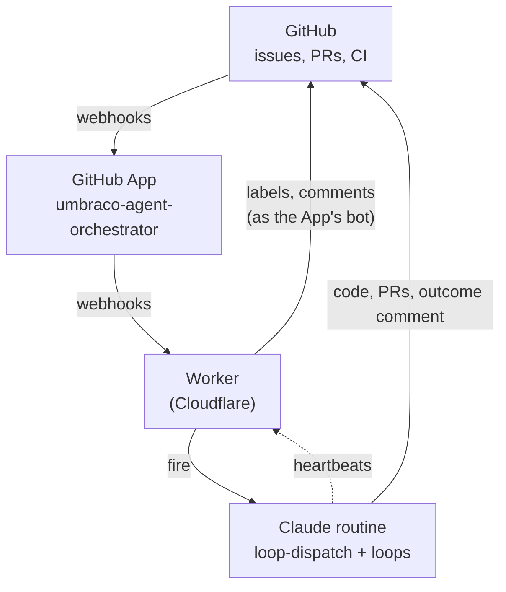
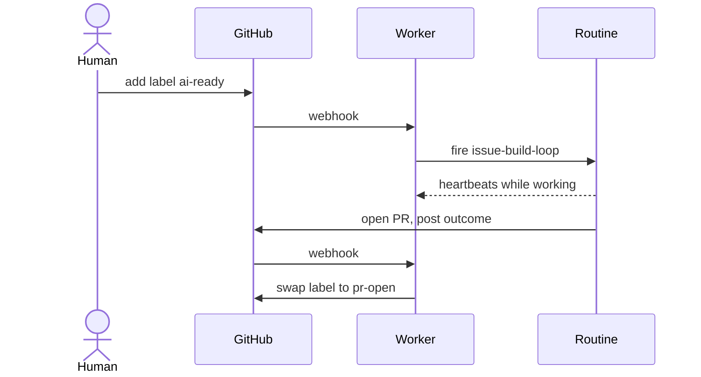
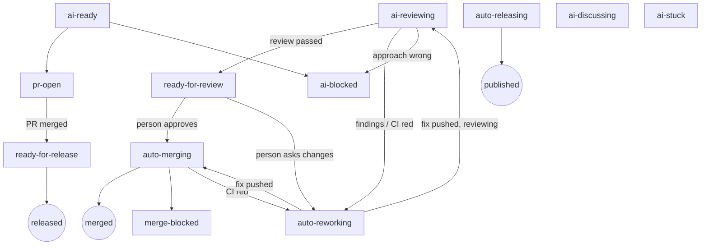
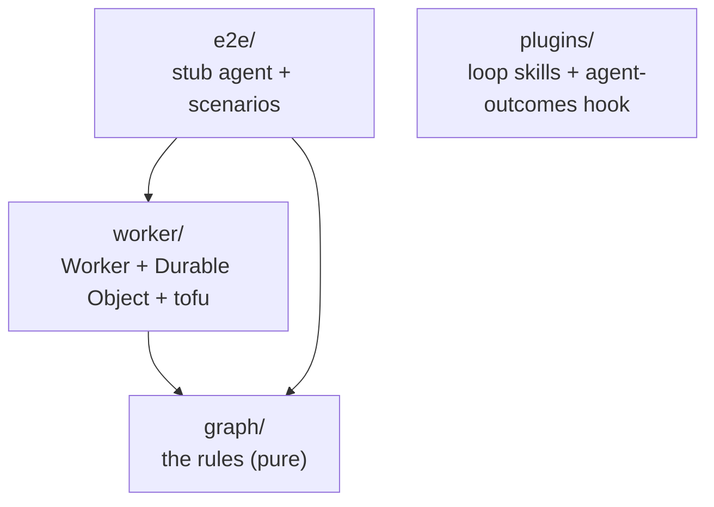
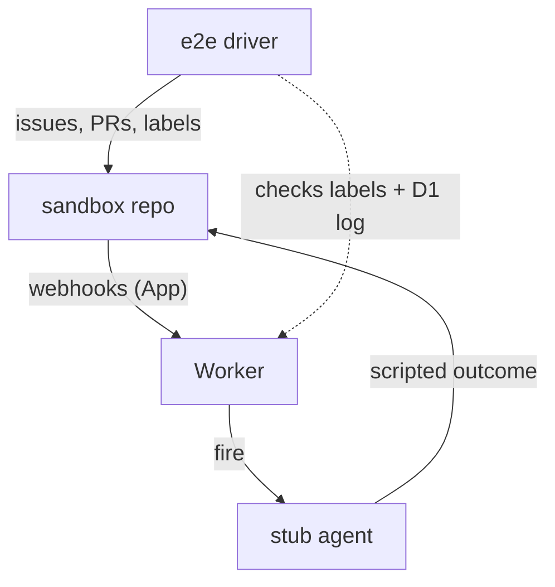

# 4. How it fits together

[← Previous: The components](03-components.md) | [Index](00-index.md) | [Next: Technical elements →](05-technical-elements.md)

---

How the system works as built (02-10-2026). Five simple views: the parts,
one run, the labels, the code, and how it's tested.

## The parts

- **GitHub** is where the state lives: one label per issue or PR says where
  it is.
- **The GitHub App** is the Worker's identity and its webhook source. A repo
  is connected by installing the App on it.
- **The Worker** decides what happens next and is the only thing that
  changes the labels. Each issue gets its own Durable Object, which handles
  one event at a time. D1 keeps a log of every decision.
- **The routine** does the work: build, rework, merge, release. It reports
  the outcome by commenting on GitHub, which comes back as a webhook.
- **Heartbeats** (dashed) only tell the Worker a run is still alive. They
  never change state.
- **Deployed** with OpenTofu (`worker/terraform/`) to Cloudflare.

## One run

If the routine goes quiet for its whole timeout, the Worker's watchdog
moves the issue to `ai-stuck` and comments the last step it reported.

## The labels

- **Issues:** `ai-ready` builds. The outcome is `pr-open` (a PR) or
  `ai-blocked`. Once the PR merges, the issue moves to `ready-for-release`
  and waits; the release whose tag contains that merge closes it.
- **Discussion:** `ai-discussing` runs issue-discuss-loop while a human and
  the agent go back and forth; it comes off only when a human swaps it for
  something else (`ai-ready` to build, or it's dropped after a capped
  number of rounds).
- **The review (on the PR):** `ai-reviewing` is added by the build (or a
  person) once the PR opens. It waits for green CI, then runs the
  adversarial review. Findings or red CI send it to `auto-reworking`; a
  passed review moves to `ready-for-review`, parked for a person to approve
  the merge (`auto-merging`), ask for changes (`auto-reworking`), or re-run
  the review. "The approach is wrong" goes straight to `ai-blocked`.
- **PRs:**
  - `auto-merging` merges once CI is green.
  - A conflict or requested changes → `merge-blocked`, for a human.
  - Red CI → `auto-reworking` to fix it, then back to `auto-merging` (or
    `ai-reviewing`, if the fix was for the review). After three tries at
    either CI-fix cycle, or three review-rework rounds, it goes to
    `ai-stuck` instead of looping forever.
- **Releases:** `auto-releasing` prepares and reviews; once the Worker
  merges it, `release-publish` (a routine, not a label — the issue stays
  labelled `auto-releasing`) posts the note and syncs `dev`; the Worker
  then closes the issue.
- **`ai-stuck`:** reached when a fired run goes quiet past its timeout
  (the watchdog), or a CI-fix / review-rework cycle hits its cap. Re-adding
  the relevant trigger label retries it with a fresh count.

## The code

- **`graph/`**: what each label plus event leads to (`graph.ts`), and how a
  webhook becomes an event. No I/O.
- **`worker/`**: the Worker, the per-issue Durable Object, the GitHub App
  client, the D1 log and the OpenTofu deploy.
- **`e2e/`**: the stub agent and the scenario suite.
- **`plugins/`**: the skills the routines run (loop-dispatch, the loops,
  merge-flow), plus the hook that sends heartbeats. They're released through
  the marketplace.

## How it's tested

- **The stub** stands in for the routines and does no AI work. The driver
  runs the scenarios against a real GitHub sandbox through the real Worker.
- **The audit** at the end checks every webhook the Worker answered against
  its D1 log.
- **Unit tests** cover `graph/` and `worker/`. Evals check the real agents
  follow their skills. See [14-e2e-testing.md](14-e2e-testing.md).

## Not built yet

These are in the design but not in the diagrams:
- the live-status view and dashboard (Phase 8)
- the reconciliation sweep (Phase 7)

---

[Next: 05 — Technical elements →](05-technical-elements.md)
